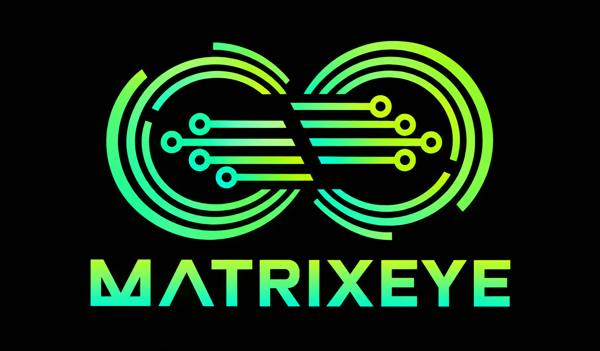

<p align="center">
  
</p>

<p align="center"><strong>Turn any website into a source-grounded, conversational assistant.</strong><br>
Crawl a site, index it, and answer visitors' questions with citations, or an honest "I couldn't find that".</p>

---

## Status

**Phases 1-3 (core engine; SDK, chat widget, streaming; marketing and documentation website) are built and tested.** A website is crawled (including
JavaScript sites), questions are answered with citations by a local or hosted language model (or by quoting the site),
and a one-line script puts an accessible chat window on any page.

| Piece | State |
|---|---|
| Crawler, store, retrieval, grounded answers, validation, API, CLI | built, evaluated on 3 real sites |
| Streaming answers (server-sent events) | built; provisional text is replaced by the validated answer |
| TypeScript SDK | built, tested against the real server and as published ES/CJS output |
| Chat widget (script tag, web component, `init()`) | built, ~10 KB gzipped; tested in real Chromium incl. axe-core accessibility audit |
| React / Next.js component | built, server-side-rendering safe |
| Local model (Ollama) | verified with `qwen3:4b-instruct` |
| Marketing and documentation website ([docs/website.md](docs/website.md)) | built, tested, **not deployed** (no domain or host yet) |
| Dashboard, hosted service, billing | not started (Phase 4) |
| Real screen-reader testing, npm/CDN publishing, domain | not done |

The evaluation harness (`npm run eval`) scores 100% on its 48-question fixture set in the default mode and 97.4% with a
model. Treat that as a *regression baseline*, not a promise of real-world accuracy: it is one small synthetic site that the
engine was tuned against. Real-site results are the real test.

## Quick start

Requires **Node.js 24+**.

```bash
npm install
npm test            # 381 tests, including a real browser (skipped if Chromium is not installed)
npm run eval        # answer-quality report against the fixture site (add -- --gate for CI behaviour)
npm run typecheck
```

### Try it on a real website (no server, no model needed)

```bash
npm run matrix -- crawl https://your-university.edu --max-pages 100
npm run matrix -- ask "How much is tuition for computer science?"
npm run matrix -- chat                      # interactive, remembers follow-ups
npm run matrix -- search "application deadline"
npm run matrix -- pages
```

Sites built with React/Vue send an empty page until JavaScript runs (the crawl will index 0 pages). Add
`--render` (one-time setup: `npx playwright install chromium`):

```bash
npm run matrix -- crawl https://your-react-site.org --max-pages 30 --render
```

Without a language model, answers are **extractive**: sentences quoted from the site with their sources. They are accurate
and cannot hallucinate, but they cannot summarise. With a model, the same passages become a natural, cited answer.

**If [Ollama](https://ollama.com) is running on your computer, the CLI and the demo find and use it automatically.** No
settings are needed, and they say so when they do (`--no-model` forces quoted answers):

```bash
ollama pull qwen3:4b-instruct          # once: 2.5 GB, Apache-2.0, a NON-thinking model
npm run matrix -- llm-check             # confirms the model works
npm run matrix -- chat
```

To use another OpenAI-compatible server (vLLM, LM Studio, a hosted API), set `MATRIX_EYE_LLM_BASE_URL` and `MATRIX_EYE_LLM_MODEL`;
explicit settings always win over detection. The API server never auto-detects: a deployment must name its model.

Use non-thinking models; see [ADR-005](docs/adr/ADR-005-language-model-and-ollama.md) for why and for measured results.

Score it against your own labelled questions: copy `evals/datasets/education-demo.json`, write questions
and expected pages for your site, then `npm run eval -- --url https://your-university.edu --dataset my.json`.

### See the chat widget on any site (one command)

```bash
npm run demo -- https://www.reed.edu --max-pages 40
npm run demo -- https://your-react-site.org --render --max-pages 20
```

It reads the site, then serves a page at http://localhost:8788 with the real widget answering from it. Add the
language-model variables above for conversational, streamed answers. Try `?theme=dark`, `?position=left`, `?color=%231b6b4a`.

### Add the widget to a website

```html
<script src="https://YOUR-HOST/matrix-eye-widget.js" defer
        data-project="PROJECT_ID" data-api="https://YOUR-API-HOST"></script>
```

The project must list the website's origin first (`PATCH /v1/projects/:id/settings`). Full guide: [docs/widget.md](docs/widget.md).
TypeScript client for servers and browsers: [docs/sdk.md](docs/sdk.md).

### Run the API

```bash
cp .env.example .env     # set MATRIX_EYE_API_KEY (16+ chars)
npm run dev:api
curl -H "authorization: Bearer $MATRIX_EYE_API_KEY" -X POST localhost:8787/v1/projects \
     -H "content-type: application/json" -d '{"name":"My Uni","siteUrl":"https://your-university.edu"}'
```

Endpoints, including the public widget endpoints and streaming events, are documented in [docs/api.md](docs/api.md).

## How it works

```
 website --crawl--> pages --chunk--> passages --index--> SQLite FTS5 (BM25)
                                                              |
 visitor question --> rules? --> contact facts? --> retrieve --> gates --> answer --> validate --> cited reply
                                                                  |                       |
                                                           abstain if the site     model output checked
                                                           doesn't cover it        against the evidence
```

- **Safe crawler:** obeys robots.txt, blocks SSRF (including DNS rebinding), caps response size, drops
  prompt-injection text. See [ADR-004](docs/adr/ADR-004-crawler-safety.md).
- **Grounded answers:** every factual answer cites the page it came from; invented prices, dates and
  contacts are caught before they reach a visitor. See [ADR-003](docs/adr/ADR-003-grounded-answers-and-abstention.md).
- **Works with or without a language model**, hosted or self-hosted, through one small interface.

## Repository layout

```
packages/
  core/        shared types, errors, tunable defaults, text helpers
  crawler/     SSRF-safe fetcher, robots.txt, sitemaps, content extraction, crawl loop
  knowledge/   chunker + KnowledgeStore interface + SQLite FTS5 implementation
  llm/         LlmProvider interface, OpenAI-compatible client, scripted test double
  engine/      rules, follow-up rewriting, retrieval gates, prompts, validation, ingestion
  testing/     fixture websites and a local server for offline tests
  sdk/         TypeScript client (admin + visitor), streaming, tested against the real API
  widget/      embeddable chat widget (web component, Shadow DOM), ~10 KB gzipped
  widget-react/ React / Next.js component
apps/
  api/         Fastify HTTP API (admin routes + key-less public routes for the widget)
  cli/         `matrix` command line tool
  demo/        `npm run demo`: read a site and chat with it through the real widget
evals/         labelled questions, scoring, report + CI quality gate
docs/          website.md, api.md, architecture decision records (adr/), planning PDFs (planning/)
brand/         logos
```

## Known limitations (Phase 1)

- Retrieval is keyword-based (BM25 plus hand-written synonyms). Unusual wording can be wrongly declined;
  semantic retrieval is planned and will be adopted only if it wins on the evaluation set.
- `--render` is slow (3-6 s per page) and uses a real browser; the browser's DNS cannot be pinned, so run it in an
  isolated sandbox for untrusted URLs in a hosted setting (ADR-004).
- Without a language model, answers are quoted sentences: accurate and cited, but they can land on the right page and
  quote the wrong part, and they cannot summarise. A model (Ollama etc.) is the intended way to get conversational answers.
- A single admin API key (per-project keys, quotas and billing come with the hosted service).
- The widget's origin check stops other *websites* embedding it, not scripts outside a browser; those are rate-limited (ADR-006).
- Accessibility is tested automatically (axe-core) but not yet with real screen readers.
- The `matrixeye.ai` addresses (branding link, crawler user-agent) are placeholders until a domain is chosen.
- `node:sqlite` is flagged experimental by Node and prints a warning.
- English-oriented text processing.

## Contributing and security

See [CONTRIBUTING.md](CONTRIBUTING.md) and [SECURITY.md](SECURITY.md).

## License

[Apache License 2.0](LICENSE).
